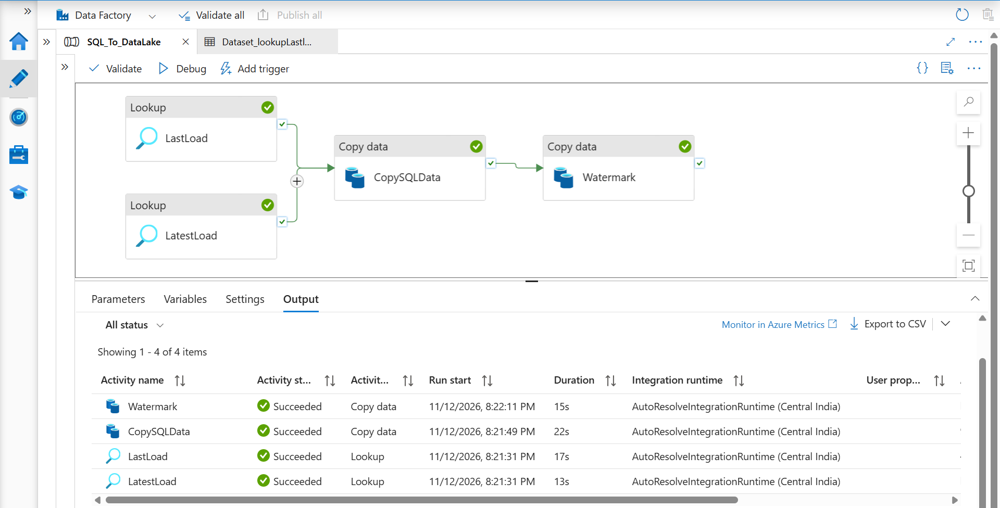
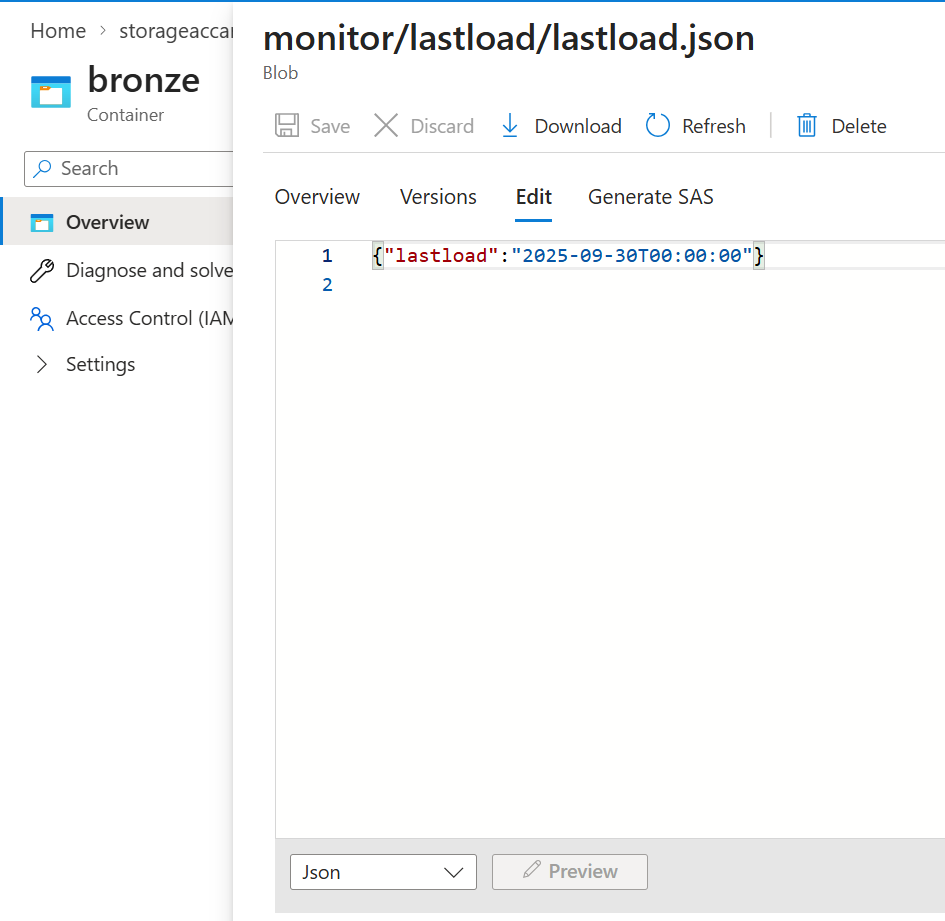
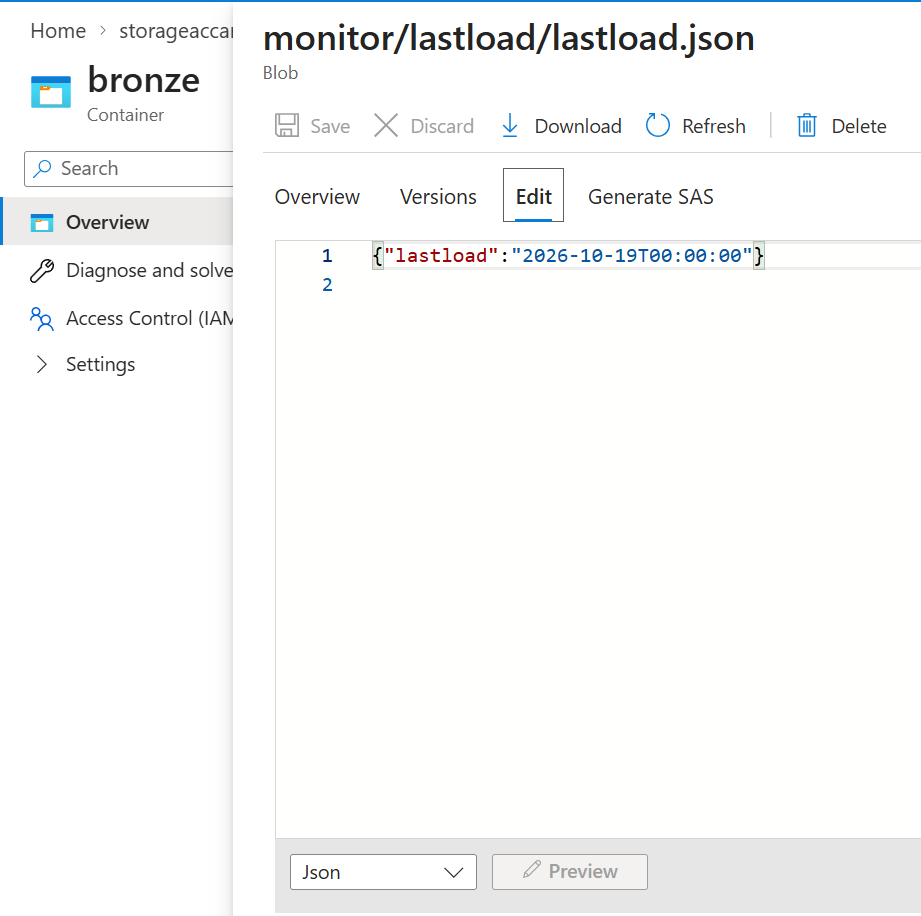
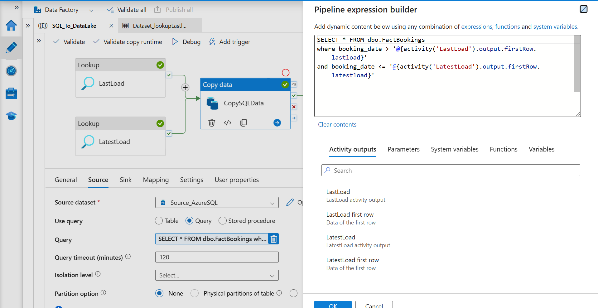
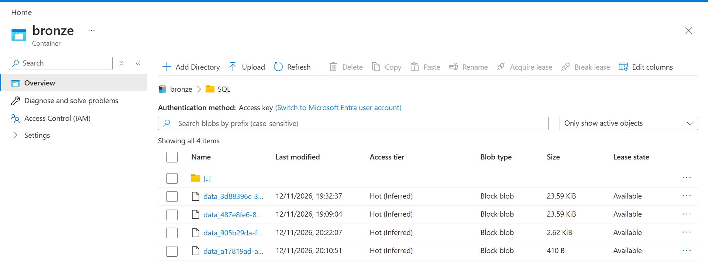

# ADF Incremental Load: Azure SQL to Data Lake (Watermark Pattern)

An Azure Data Factory (ADF) pipeline that loads **only the new rows** from an Azure SQL table into Azure Data Lake Storage Gen2 as Parquet files. It remembers where the last load stopped using a small **watermark file** (`lastload.json`), so each run picks up from there instead of copying the whole table again.



## The idea in plain words

Think of a bookmark in a book. The bookmark remembers the last page you read, so next time you start from there instead of page one. Here the "book" is the `FactBookings` table, the "page" is a date (`booking_date`), and the "bookmark" is the file `lastload.json`. After every successful load, the pipeline moves the bookmark forward to the newest date it has copied.

## What it does

```
LastLoad (Lookup)  ──┐
                     ├──►  CopySQLData  ──►  Watermark
LatestLoad (Lookup) ─┘
```

| Step | Activity | What it does |
|---|---|---|
| 1 | `LastLoad` (Lookup) | Reads `lastload.json` from the data lake to get the date where the previous load stopped |
| 1 | `LatestLoad` (Lookup) | Runs `SELECT max(booking_date)` on the SQL table to get the newest date available now |
| 2 | `CopySQLData` (Copy data) | Copies only the rows between those two dates from Azure SQL to the data lake as Parquet |
| 3 | `Watermark` (Copy data) | Writes the newest date into `lastload.json`, ready for the next run |

The two Lookup activities run at the same time. `CopySQLData` starts once both have succeeded, and `Watermark` runs only after `CopySQLData` succeeds. If the data copy fails, the bookmark is not moved.

## The key expressions

**Copy query** (in `CopySQLData`, Source → Use query):

```sql
SELECT * FROM dbo.FactBookings
WHERE booking_date > '@{activity('LastLoad').output.firstRow.lastload}'
  AND booking_date <= '@{activity('LatestLoad').output.firstRow.latestload}'
```

Using `>` for the start and `<=` for the end means no row is loaded twice and no row is skipped between runs.

**Newest date** (in `LatestLoad`):

```sql
SELECT max(booking_date) as latestload
FROM dbo.FactBookings
```

**Updating the watermark** (in `Watermark`): the Copy activity reads a placeholder JSON file and adds one extra column, then writes the result over `lastload.json`:

| Setting | Value |
|---|---|
| Source dataset | `DS_EmptyJSON` (placeholder file `empty.json`) |
| Additional column name | `lastload` |
| Additional column value | `@activity('LatestLoad').output.firstRow.latestload` |
| Sink dataset | `Dataset_lookupLastload` (the same `lastload.json` the Lookup reads) |

## The watermark file

`lastload.json` holds one value:

```json
{"lastload":"2025-09-30T00:00:00"}
```



Set the starting value to a date **earlier than your oldest booking**, so the first run loads everything. After each run, the pipeline replaces it with the newest `booking_date` it copied.



## Storage layout

In Data Lake Storage Gen2, `bronze` is the container and the rest are folders:

```
bronze/
└── monitor/
    ├── lastload/
    │   └── lastload.json     (the watermark)
    └── emptyjson/
        └── empty.json        (placeholder used to update the watermark)
```

The copied data is written as Parquet files in the data lake through the `Sink_SQL_Parquet` dataset.

## Components

| Component | Details |
|---|---|
| Pipeline | `SQL_To_DataLake` |
| Source | Azure SQL Database, table `dbo.FactBookings`, dataset `Source_AzureSQL` |
| Destination | Azure Data Lake Storage Gen2, Parquet, dataset `Sink_SQL_Parquet` |
| Watermark datasets | `Dataset_lookupLastload` (`lastload.json`), `DS_EmptyJSON` (`empty.json`) |
| Activities | 2 Lookup, 2 Copy data |
| Integration runtime | AutoResolveIntegrationRuntime (Central India) |




## How to recreate it

1. Create an Azure SQL Database with a table that has a date column (here `dbo.FactBookings` with `booking_date`).
2. In your data lake, create the folders `monitor/lastload` and `monitor/emptyjson` inside the `bronze` container. Upload `lastload.json` (with an early starting date) and a placeholder `empty.json`.
3. Create linked services for Azure SQL and Data Lake Storage Gen2, then the datasets: `Source_AzureSQL`, `Sink_SQL_Parquet`, `Dataset_lookupLastload`, `DS_EmptyJSON`.
4. Add the `LastLoad` Lookup (dataset `Dataset_lookupLastload`, First row only on) and the `LatestLoad` Lookup (query `SELECT max(booking_date) as latestload FROM dbo.FactBookings`).
5. Add the `CopySQLData` Copy activity with the query above, a Parquet sink, and success links from both Lookups.
6. Add the `Watermark` Copy activity with the additional column and a success link from `CopySQLData`.
7. **Publish all**, then **Debug**. Check `lastload.json` before and after the run.
8. Insert new rows into the table and run again. Only the new rows should be copied.

## Result

All four activities succeed, the new rows land in the data lake as Parquet, and `lastload.json` moves forward to the newest `booking_date`. Running the pipeline again with no new data copies nothing new.

The pipeline JSON was exported from ADF Studio using the **{ }** code view. Linked services are not included because they can contain credentials.
